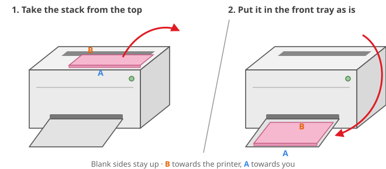

<p align="center">
  
</p>

<h1 align="center">Yazdır</h1>

<p align="center">
  <b>Booklets, N-up and guided two-sided printing for printers without a duplex unit.</b><br>
  A small GTK 4 / libadwaita app for Linux, built on CUPS.
</p>

<p align="center">
  <a href="README.tr.md">Türkçe</a> ·
  <a href="#installation">Install</a> ·
  <a href="#calibrating-manual-duplex">Calibrate</a> ·
  <a href="examples">Examples</a> ·
  <a href="docs/hp-laserjet-1018.md">HP LaserJet 1018 setup</a>
</p>

<p align="center">
  
  
  
  
</p>

<p align="center">
  
  &nbsp;
  
</p>

---

*Yazdır* is Turkish for "Print!". It started on an old HP LaserJet 1018 that can't print on both sides, and is
made for exactly that kind of printer: you turn the paper by hand, the app does the bookkeeping.

## Features

- **Guided manual duplex.** Prints the fronts, waits until the job has left the queue, then shows a picture of how to
  reload the stack. Press *Continue* and the backs land on the right sheets, the right way up.
- **Booklets.** Pages are reordered (8|1, 2|7, …) so the printed stack folds into an A5 booklet that reads in order.
- **N-up.** 1, 2, 4, 6, 9 or 16 pages per sheet. The grid and sheet orientation are chosen for the largest scale.
- **Book or calendar flip.** Choose whether the back is read by turning the sheet sideways or upwards; this works for
  portrait and landscape sheets.
- **No lost sheets.** With an odd number of sides, the last sheet's back is sent as a blank page carrying an almost
  invisible dot, so drivers that drop empty pages can't shift every following sheet.
- **Everything else you expect.** Page ranges (`1-3,5,8-`), odd/even pages, copies, collation, reverse order, fit /
  100% / custom scale, rotation, margins and borders.
- **Images too.** PNG, JPEG, WebP, TIFF… with optional *sharp black and white* (600 DPI, ideal for line art on a
  laser printer) or *AI upscaling* with [Real-ESRGAN](https://github.com/xinntao/Real-ESRGAN).
- **Tidy interface.** Everyday options up front; advanced ones in collapsible sections whose subtitles say what is
  different from the defaults. *Reset* sits next to *Print*.
- **Preview or save** the laid-out PDF instead of printing it.
- **English and Turkish**, following the system language or chosen in the app.

## How manual duplex works

<p align="center"></p>

1. Yazdır lays out every *side* of every sheet, then sends the fronts (sides 1, 3, 5, …) as one job.
2. The dialog waits for CUPS to finish that job.
3. You move the printed stack from the output tray back to the input tray as the picture shows.
4. Yazdır sends the backs (sides …, 6, 4, 2) as a second job.

Two things depend on your printer's paper path, and both are switches in **Advanced settings → Manual duplex
calibration**:

| Setting | Why it exists | Default |
|---|---|---|
| Reverse order in the second pass | Most printers stack their output so the last printed sheet ends up on top, and that sheet is the first one fed again. | On |
| Rotate backs 180° | Depending on how the stack is reloaded, the back is printed from the same edge as the front or from the opposite one. | On |

The defaults match C-path printers such as the HP LaserJet 1018/1020/P1102 (feed from the top of the stack, output face
down, reload without flipping). For other printers, print the test pages once and adjust.

## Layouts

<p align="center"></p>
<p align="center"><sub>Booklet sheet front (8 | 1) and back (2 | 7) · 2 pages per sheet · 4 pages per sheet with borders</sub></p>

## Installation

### Requirements

- Linux with CUPS (`lp`, `lpstat`)
- Python 3.10+ with PyGObject, GTK 4 and libadwaita ≥ 1.6
- ImageMagick 7 (`magick`) for printing images (PDFs work without it)

```sh
# Fedora
sudo dnf install python3-gobject gtk4 libadwaita cups-client ImageMagick
# Debian 13 / Ubuntu 24.10 or newer (libadwaita 1.6+)
sudo apt install python3-gi gir1.2-gtk-4.0 gir1.2-adw-1 cups-client imagemagick
# Arch
sudo pacman -S python-gobject gtk4 libadwaita cups imagemagick
```

### Install

```sh
git clone https://github.com/onesvat/yazdir.git
cd yazdir
./install.sh             # add --with-ai to also download Real-ESRGAN (~45 MB)
```

The installer needs no root. It creates a virtual environment in `~/.local/share/yazdir` (with access to the system
GTK bindings), links `~/.local/bin/yazdir`, and adds a menu entry, an icon and a file-manager action. It uses
[`uv`](https://github.com/astral-sh/uv) when available, otherwise `python -m venv`.

Update with `git pull && ./install.sh`. Remove with `./install.sh --uninstall` (add `--purge` to delete settings too).

## Usage

- **App menu:** *Yazdır*
- **Files (Nautilus):** right-click → *Scripts* → *Yazdır…*
- **Terminal:** `yazdir file.pdf picture.png …`
- **Drag and drop** files onto the window.

| Main options | |
|---|---|
| Print type | One-sided · Two-sided (manual) · Booklet |
| Flip | Like a book (sideways) · Like a calendar (upwards) |
| Pages per sheet | 1 · 2 · 4 · 6 · 9 · 16 |
| Copies | 1–99 (two-sided copies are always collated) |

| Advanced section | Options |
|---|---|
| Paper and quality | A4 · A5 · Letter · Legal, Normal / Draft, margin |
| Pages and copies | page range, odd/even subset, reverse order, collate |
| Layout and scale | page order, borders, fit / actual size / custom %, rotation |
| Images | none · sharp black and white · AI + sharp |
| Manual duplex calibration | reverse second pass, rotate backs, extra note, test pages |
| Application | language |

Settings are remembered in `~/.config/yazdir/settings.json`. *Reset* restores the print defaults but keeps the printer,
the file list, the calibration and the language.

## Calibrating manual duplex

1. Open **Advanced settings → Manual duplex calibration** and press **Print test pages** (2 sheets).
2. Reload the stack as the dialog shows and press **Continue**.
3. Check the result: page 2 should be on the back of page 1, page 4 on the back of page 3, and **↑ TOP ↑** should be on
   the same edge on both sides when you turn the sheet like a book.

| What you see | Fix |
|---|---|
| The backs are upside down | toggle *Rotate backs 180°* |
| The backs are on the wrong sheets (e.g. 4 behind 1) | toggle *Reverse order in the second pass* |
| You reload differently from the picture | write your own steps in *Extra note*; the dialog shows it |

## Example set

[`examples/`](examples) has seven ready-to-print documents in [English](examples/en) and [Turkish](examples/tr). They are
useful on their own and double as a test for every mode. Each page has a small header with the test code,
**↑ TOP ↑** and the page number.

| # | File | What it is | Settings | Sheets | Expected |
|---|---|---|---|---|---|
| T1 | `1-weekly-planner.pdf` | 4 weekly planners | Two-sided, book | 2 | 1 backs onto 2, 3 onto 4 |
| T2 | `2-note-pages.pdf` | ruled, squared, dot grid, Cornell | Two-sided, book | 3 | the last sheet passes through blank |
| T3 | `3-pocket-planner-booklet.pdf` | A5 pocket planner, Nov 2026 – Oct 2027 | Booklet | 2 | fold in half: reads 1 → 8 |
| T4 | `4-lists-2up.pdf` | shopping and to-do lists (A5) | Two-sided, book, 2 per sheet | 2 | 1·2 backs onto 3·4 |
| T5 | `5-recipe-cards-4up.pdf` | 16 recipe cards (A6) | Two-sided, book, 4 per sheet, borders | 2 | cut along the borders |
| T6 | `6-monthly-calendar.pdf` | Nov 2026 – Feb 2027 | Two-sided, calendar | 2 | turn upwards to read the back |
| T7 | `7-trackers.pdf` | habit tracker, reading list, goals | Two-sided, book, 2 copies | 4 | two sets; two sheets pass blank |

The sources are [Typst](https://typst.app) files in [`examples/src`](examples/src); one source builds both languages.

## Printer notes

- **HP LaserJet 1018 / 1020 / P1102 and similar:** they need HP's plugin for the firmware and the `hpcups` driver. See
  [docs/hp-laserjet-1018.md](docs/hp-laserjet-1018.md).
- Jobs are sent with `lp -o scaling=100` because Yazdır already sizes every side to the paper. `OutputMode`
  (Normal/Draft) is an `hpcups` option; other drivers ignore it.
- Most printers can't print the outer ~4 mm, hence the 5 mm default margin.

## Language

The interface follows the system language (`LANGUAGE`, `LC_ALL`, `LC_MESSAGES`, `LANG`). To override it, choose a
language in **Advanced settings → Application**, or start with `YAZDIR_LANG=tr yazdir`.

Translations live in `src/yazdir/locale/<lang>.po` and are read directly, so there is nothing to compile. To add a
language, copy `yazdir.pot` to `<lang>.po`, translate it, add the code to `LANGUAGES` in `src/yazdir/i18n.py`, and
optionally add a `feed-diagram-<lang>.svg`.

## Development

```sh
just setup        # .venv with the system GTK bindings, editable install, pytest and ruff
just test         # engine tests (layout order, booklet, blank sides, rotation, passes)
just lint
just run tr       # run from the source tree in Turkish
just examples     # rebuild the example PDFs (needs typst)
just pot          # update the translation template and merge into tr.po
just screenshots  # re-render the README screenshots without printing
```

```
src/yazdir/
  engine.py        imposition: page selection, N-up, booklet, duplex sides and passes
  app.py           GTK 4 / libadwaita interface and CUPS calls
  i18n.py          tiny .po reader
  data/            feed diagrams
  locale/          yazdir.pot, tr.po
examples/          example set (en, tr) and its Typst sources
tools/             screenshot script
tests/             pytest suite for the engine
```

The engine is plain Python on top of [pypdf](https://github.com/py-pdf/pypdf): each source page is placed on a sheet with
a transformation matrix, landscape sheets are turned into portrait paper, and backs are turned 180° when the flip, the
sheet orientation and the calibration call for it.

## License

[MIT](LICENSE) © 2026 Onur Neşvat
