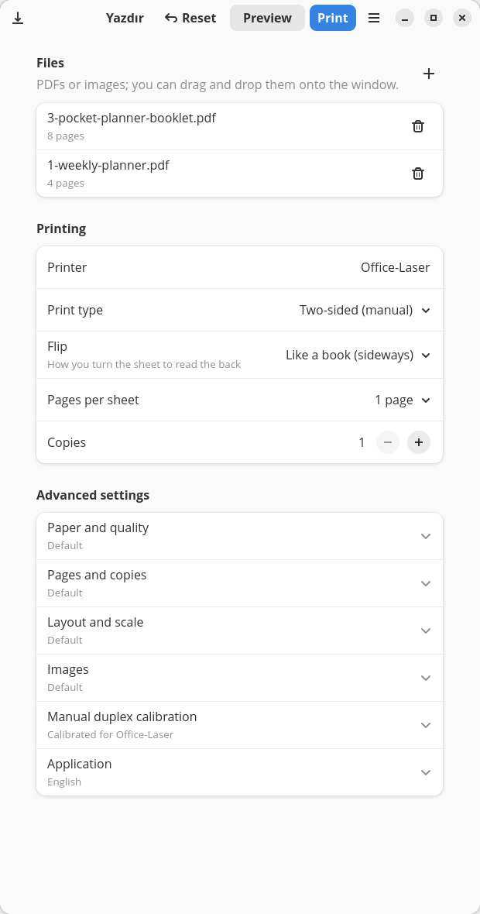
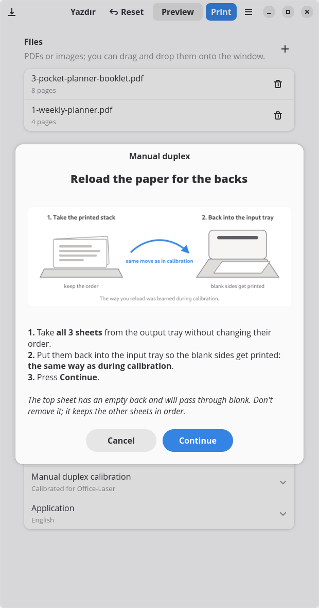
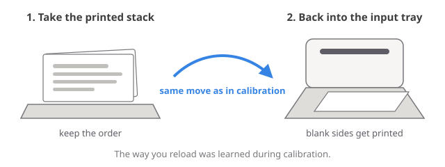
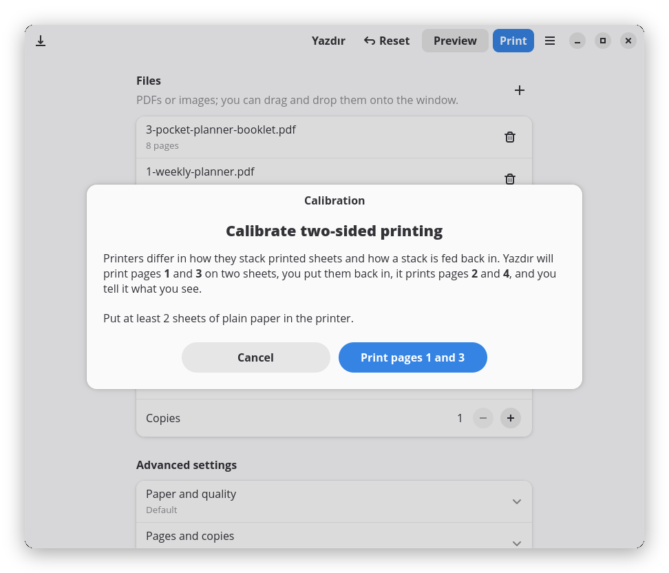
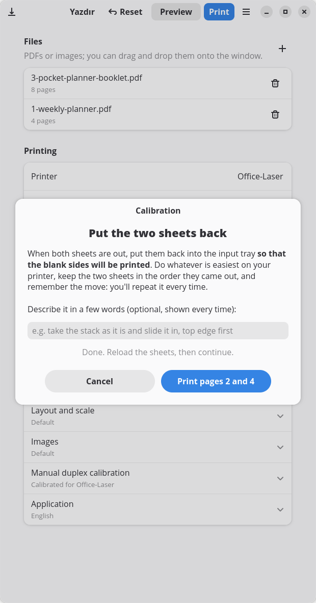
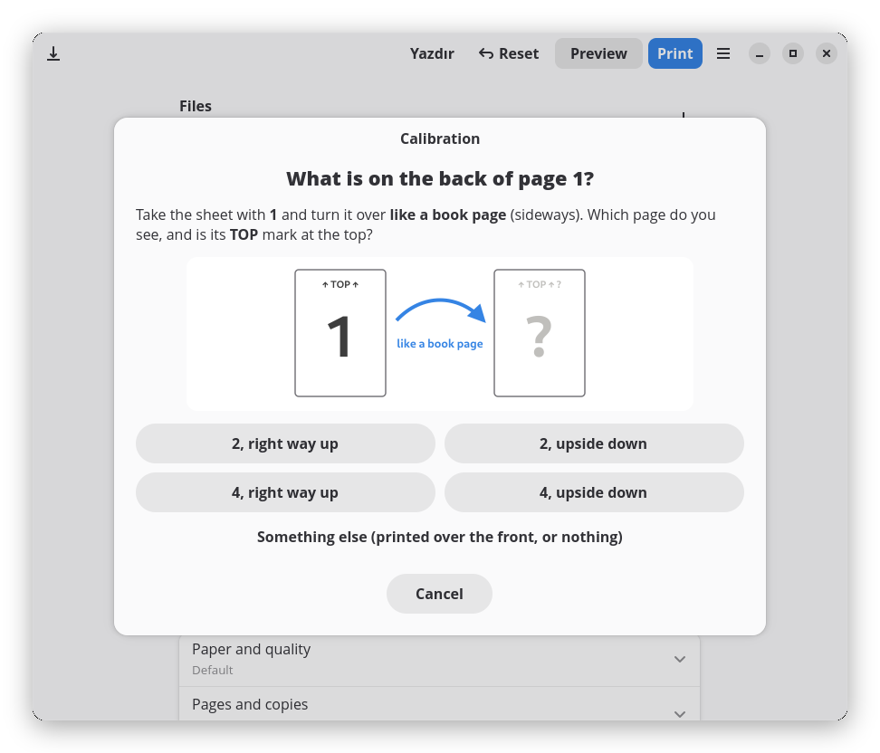

<p align="center">
  
</p>

<h1 align="center">Yazdır</h1>

<p align="center">
  <b>Booklets, N-up and guided two-sided printing for any printer without automatic duplex.</b><br>
  A small GTK 4 / libadwaita app for Linux, built on CUPS.
</p>

<p align="center">
  <a href="README.tr.md">Türkçe</a> ·
  <a href="#installation">Install</a> ·
  <a href="#calibration">Calibration</a> ·
  <a href="examples">Examples</a>
</p>

<p align="center">
  <a href="https://github.com/onesvat/yazdir/actions/workflows/ci.yml"></a>
  
  
  
  
</p>

<p align="center">
  
  &nbsp;
  
</p>

---

Plenty of printers, from old office lasers to cheap inkjets, can't print on both sides of the paper by themselves.
You *can* do it by hand, but getting the backs onto the right sheets, the right way up, usually takes a few wasted
pages. *Yazdır* (Turkish for "Print!") does the bookkeeping: it lays out the pages, prints the fronts, tells you when
and how to reload the stack, and prints the backs.

## Features

- **Calibration for any printer.** Two sheets and one question teach Yazdır how your printer stacks and feeds paper.
  The result is remembered per printer.
- **Guided two-sided printing.** Prints the fronts, waits until the job has left the queue, then shows how to reload.
  Press *Continue* and the backs come out on the right sheets, the right way up.
- **Booklets.** Pages are reordered (8|1, 2|7, …) so the printed stack folds into a booklet that reads in order.
- **N-up.** 1, 2, 4, 6, 9 or 16 pages per sheet; the grid and sheet orientation are chosen for the largest scale.
- **Book or calendar flip.** Choose whether the back is read by turning the sheet sideways or upwards, for portrait and
  landscape sheets alike.
- **No lost sheets.** With an odd number of sides the last back is sent as a blank page carrying an almost invisible
  dot, so drivers that skip empty pages can't shift the rest of the stack.
- **Everything else you expect.** Page ranges (`1-3,5,8-`), odd/even pages, copies, collation, reverse order, fit /
  100% / custom scale, rotation, margins and borders.
- **Images too.** PNG, JPEG, WebP, TIFF… optionally converted to crisp 600 DPI black and white, which looks much better
  than greyscale on a laser printer.
- **Tidy interface.** Everyday options up front; advanced ones in collapsible sections whose subtitles say what is
  different from the defaults. *Reset* sits next to *Print*.
- **Preview or save** the laid-out PDF instead of printing it.
- **English and Turkish**, following the system language or chosen in the app.

## How it works

<p align="center"></p>

1. Yazdır lays out every *side* of every sheet and sends the fronts (sides 1, 3, 5, …) as one job.
2. The dialog waits for CUPS to finish that job.
3. You put the printed stack back into the input tray, the same way you did during calibration.
4. Yazdır sends the backs (…, 6, 4, 2 or 2, 4, 6, …) as a second job.

Two things depend on the printer's paper path:

- **Order.** Most printers stack their output so the last printed sheet ends up on top, and that sheet is the first one
  fed again. Then the backs must be sent in reverse order.
- **Rotation.** Depending on how the stack goes back in, the printer starts the back from the same edge as the front or
  from the opposite one. Then the backs must be turned 180° to read correctly.

Calibration finds out both.

## Calibration

<p align="center">
  
  
  
</p>

The first time you print two-sided on a printer, Yazdır offers to calibrate it (you can also start it from
**Advanced settings → Manual duplex calibration**):

1. It prints pages **1** and **3** on two sheets.
2. You put the sheets back into the input tray so the blank sides will be printed, in whatever way is easiest on your
   printer. Optionally describe the move in a few words; Yazdır shows your note every time you print two-sided.
3. It prints pages **2** and **4**.
4. You turn the sheet with **1** over like a book page and say what you see: *2* or *4*, right way up or upside down.

That answer sets *Reverse order in the second pass* and *Rotate backs 180°* for that printer. Both switches stay
visible in the same section if you ever want to adjust them by hand.

## Layouts

<p align="center"></p>
<p align="center"><sub>Booklet sheet front (8 | 1) and back (2 | 7) · 2 pages per sheet · 4 pages per sheet with borders</sub></p>

## Installation

### Flatpak (recommended)

Download `yazdir-<version>-x86_64.flatpak` from the [latest release](https://github.com/onesvat/yazdir/releases/latest)
and open it with GNOME Software or KDE Discover, or install it from a terminal:

```sh
flatpak install --user yazdir-1.1.1-x86_64.flatpak
flatpak run io.github.onesvat.Yazdir
```

The file is under 2 MB; GTK and libadwaita come from the GNOME runtime, which is downloaded from Flathub the first
time if you don't have it yet. Flatpak itself comes preinstalled on Fedora, Linux Mint, Pop!_OS and openSUSE; on
Ubuntu run `sudo apt install flatpak` and add Flathub ([instructions](https://flathub.org/setup)). To update, install
the file of a newer release the same way.

You can also build the Flatpak yourself:

```sh
flatpak install --user flathub org.flatpak.Builder org.gnome.Sdk//51
git clone https://github.com/onesvat/yazdir.git && cd yazdir
flatpak run org.flatpak.Builder --user --install --force-clean --install-deps-from=flathub \
    build-dir build-aux/flatpak/io.github.onesvat.Yazdir.yml
flatpak run io.github.onesvat.Yazdir
```

The Flatpak only asks for access to CUPS (`--socket=cups`) and the display; files are opened through the standard
file chooser and drag and drop.

### From source

Requirements: Linux with CUPS, Python 3.10+ with PyGObject, GTK 4 and libadwaita ≥ 1.6, and pycups (or the `lp`
command).

```sh
# Fedora
sudo dnf install python3-gobject gtk4 libadwaita python3-cups
# Debian 13 / Ubuntu 24.10 or newer
sudo apt install python3-gi gir1.2-gtk-4.0 gir1.2-adw-1 python3-cups
# Arch
sudo pacman -S python-gobject gtk4 libadwaita python-pycups
```

```sh
git clone https://github.com/onesvat/yazdir.git
cd yazdir
./install.sh
```

The installer needs no root. It creates a virtual environment in `~/.local/share/yazdir` that can see the system GTK
bindings, links `~/.local/bin/yazdir`, and adds a menu entry, an icon and a *Scripts → Yazdır…* action for Files
(Nautilus). It uses [`uv`](https://github.com/astral-sh/uv) when available, otherwise `python -m venv`.

`./install.sh --with-ai` also downloads [Real-ESRGAN](https://github.com/xinntao/Real-ESRGAN) (~45 MB), which adds an
*AI upscaling* option for low-resolution images. Update with `git pull && ./install.sh`; remove with
`./install.sh --uninstall` (add `--purge` to delete the settings too).

## Usage

- **App menu:** *Yazdır*
- **Open with:** right-click a PDF or image → *Open With* → *Yazdır*
- **Terminal:** `yazdir file.pdf picture.png …`
- **Drag and drop** files onto the window

| Main options | |
|---|---|
| Print type | One-sided · Two-sided (manual) · Booklet |
| Flip | Like a book (sideways) · Like a calendar (upwards) |
| Pages per sheet | 1 · 2 · 4 · 6 · 9 · 16 |
| Copies | 1–99 (two-sided copies are always collated) |

| Advanced section | Options |
|---|---|
| Paper and quality | A4 · A5 · Letter · Legal, Normal / Draft, margin |
| Pages and copies | page range, odd/even subset, reverse order, collate |
| Layout and scale | page order, borders, fit / actual size / custom %, rotation |
| Images | none · sharp black and white (· AI + sharp with `--with-ai`) |
| Manual duplex calibration | calibrate, reverse second pass, rotate backs, your reload note |
| Application | language |

Settings are stored in `~/.config/yazdir/settings.json` (inside Flatpak: `~/.var/app/io.github.onesvat.Yazdir/config`).
*Reset* restores the print defaults and keeps the printer, the file list, the calibrations and the language.

## Example set

[`examples/`](examples) has seven ready-to-print documents in [English](examples/en) and [Turkish](examples/tr). They
are useful on their own and exercise every mode. Each page has a small header with the test code, **↑ TOP ↑** and the
page number, so a mistake is easy to spot.

| # | File | What it is | Settings | Sheets | Expected |
|---|---|---|---|---|---|
| T1 | `1-weekly-planner.pdf` | 4 weekly planners | Two-sided, book | 2 | 1 backs onto 2, 3 onto 4 |
| T2 | `2-note-pages.pdf` | ruled, squared, dot grid, Cornell | Two-sided, book | 3 | the last sheet passes through blank |
| T3 | `3-pocket-planner-booklet.pdf` | A5 pocket planner, Nov 2026 – Oct 2027 | Booklet | 2 | fold in half: reads 1 → 8 |
| T4 | `4-lists-2up.pdf` | shopping and to-do lists (A5) | Two-sided, book, 2 per sheet | 2 | 1·2 backs onto 3·4 |
| T5 | `5-recipe-cards-4up.pdf` | 16 recipe cards (A6) | Two-sided, book, 4 per sheet, borders | 2 | cut along the borders |
| T6 | `6-monthly-calendar.pdf` | Nov 2026 – Feb 2027 | Two-sided, calendar | 2 | turn upwards to read the back |
| T7 | `7-trackers.pdf` | habit tracker, reading list, goals | Two-sided, book, 2 copies | 4 | two sets; two sheets pass blank |

The sources are [Typst](https://typst.app) files in [`examples/src`](examples/src); one source builds both languages.

## Printer notes

- Jobs are sent with scaling turned off, because Yazdır already sizes every side to the paper.
- Print quality is sent as the standard `print-quality` attribute, plus `OutputMode` for drivers that use that PPD
  option instead.
- Most printers can't print the outer ~4 mm of the sheet, hence the 5 mm default margin.
- Some printers need extra setup on Linux (proprietary plugins, firmware). If the printer doesn't print from other
  apps either, sort that out first; Yazdır only talks to CUPS.

## Language

The interface follows the system language (`LANGUAGE`, `LC_ALL`, `LC_MESSAGES`, `LANG`). To override it, choose a
language in **Advanced settings → Application**, or start with `YAZDIR_LANG=tr yazdir`.

Translations live in `src/yazdir/locale/<lang>.po` and are read directly, so there is nothing to compile. To add a
language, copy `yazdir.pot` to `<lang>.po`, translate it, add the code to `LANGUAGES` in `src/yazdir/i18n.py`, and
optionally add `reload-<lang>.svg` and `calibration-<lang>.svg` diagrams.

## Development

```sh
just setup         # .venv with the system GTK bindings, editable install, pytest and ruff
just test          # engine tests (layout order, booklet, blank sides, rotation, passes, images)
just lint
just run tr        # run from the source tree in Turkish
just examples      # rebuild the example PDFs (needs typst)
just pot           # update the translation template and merge into tr.po
just screenshots   # re-render the README screenshots without printing
just flatpak       # build and install the Flatpak
just bundle        # build the single-file .flatpak for a release
just validate      # desktop entry and AppStream checks
```

```
src/yazdir/
  engine.py        imposition: page selection, N-up, booklet, duplex sides and passes; image conversion
  printing.py      CUPS access through pycups, or lp/lpstat as a fallback
  app.py           GTK 4 / libadwaita interface, duplex dialog and calibration wizard
  i18n.py          tiny .po reader
  data/            diagrams
  locale/          yazdir.pot, tr.po
data/              desktop entry, AppStream metadata, icon
build-aux/flatpak/ Flatpak manifest
examples/          example set (en, tr) and its Typst sources
tools/             screenshot script
tests/             pytest suite for the engine
```

The engine is plain Python on top of [pypdf](https://github.com/py-pdf/pypdf) and [Pillow](https://python-pillow.org):
each source page is placed on a sheet with a transformation matrix, landscape sheets are turned into portrait paper,
and backs are turned 180° when the flip, the sheet orientation and the calibration call for it.

## License

[MIT](LICENSE) © 2026 Onur Neşvat
