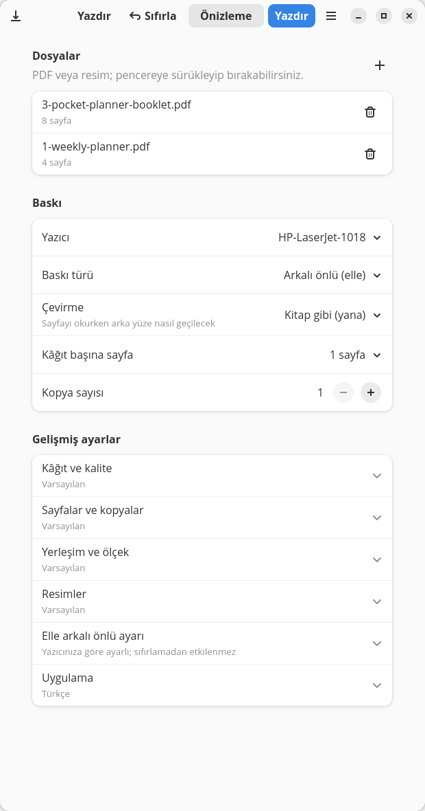
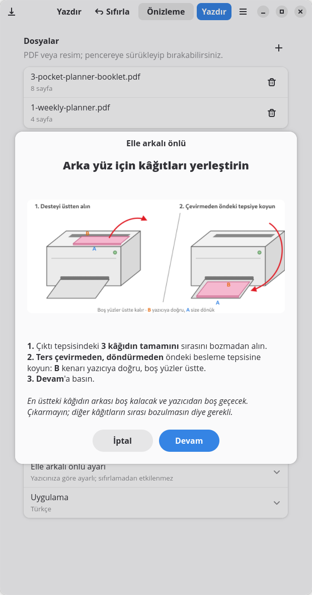
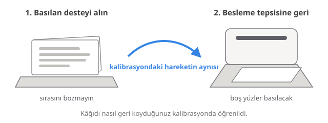
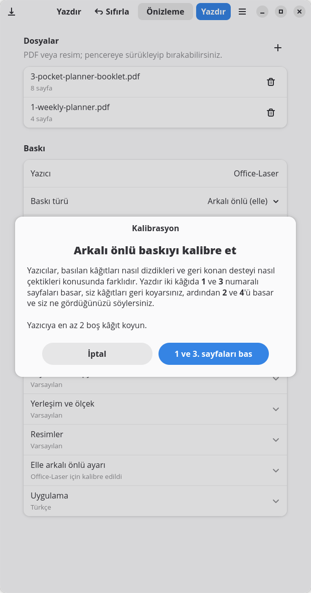
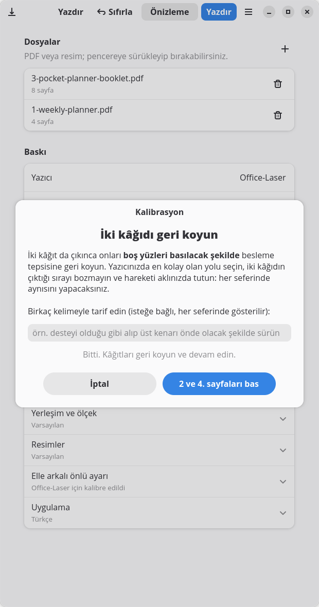
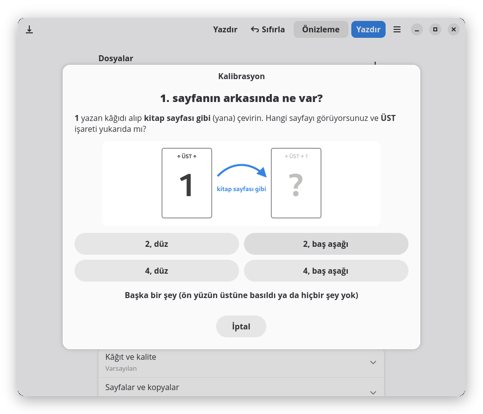
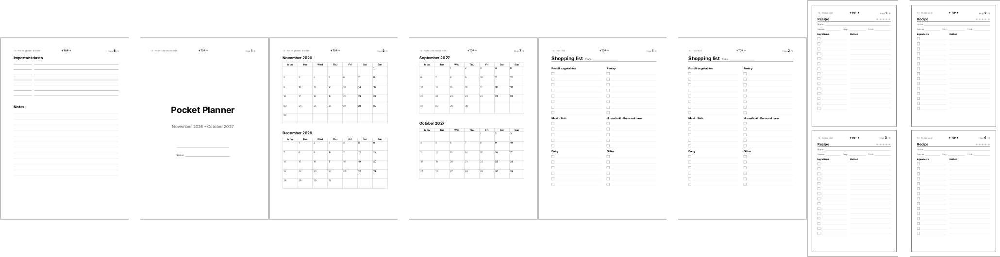

<p align="center">
  
</p>

<h1 align="center">Yazdır</h1>

<p align="center">
  <b>Otomatik arkalı önlü basamayan her yazıcı için kitapçık, kâğıt başına N sayfa ve rehberli arkalı önlü baskı.</b><br>
  Linux için CUPS üzerinde çalışan küçük bir GTK 4 / libadwaita uygulaması.
</p>

<p align="center">
  <a href="README.md">English</a> ·
  <a href="#kurulum">Kurulum</a> ·
  <a href="#kalibrasyon">Kalibrasyon</a> ·
  <a href="examples">Örnekler</a>
</p>

<p align="center">
  <a href="https://github.com/onesvat/yazdir/actions/workflows/ci.yml"></a>
  
  
  
  
</p>

<p align="center">
  
  &nbsp;
  
</p>

---

Eski ofis lazerlerinden ucuz mürekkep püskürtmelilere kadar pek çok yazıcı kâğıdın iki yüzüne kendi başına basamaz.
Bunu elle yapmak mümkün, ama arka yüzleri doğru kâğıda ve doğru yönde getirmek genelde birkaç kâğıt harcatır.
*Yazdır* bu işi üstlenir: sayfaları dizer, ön yüzleri basar, desteyi ne zaman ve nasıl geri koyacağınızı söyler ve arka
yüzleri basar.

## Özellikler

- **Her yazıcı için kalibrasyon.** İki kâğıt ve tek bir soruyla Yazdır, yazıcınızın kâğıdı nasıl dizip çektiğini öğrenir.
  Sonuç her yazıcı için ayrı saklanır.
- **Rehberli arkalı önlü baskı.** Ön yüzleri basar, iş kuyruktan çıkana kadar bekler, sonra desteyi nasıl geri
  koyacağınızı gösterir. *Devam*'a basınca arka yüzler doğru kâğıda, doğru yönde basılır.
- **Kitapçık.** Sayfalar yeniden dizilir (8|1, 2|7, …); basılan deste ortadan katlanınca sırayla okunan bir kitapçık olur.
- **Kâğıt başına N sayfa.** 1, 2, 4, 6, 9 ya da 16 sayfa; ızgara ve kâğıt yönü en büyük ölçeği verecek şekilde seçilir.
- **Kitap gibi ya da takvim gibi çevirme.** Arka yüzün yana mı yukarı mı çevrilerek okunacağını seçersiniz; dikey ve
  yatay kâğıtlarda aynı şekilde çalışır.
- **Kâğıt kaymaz.** Yüz sayısı tekse son arka yüz, üzerinde neredeyse görünmeyen bir nokta olan boş bir sayfa olarak
  gönderilir. Böylece boş sayfaları atlayan sürücüler destenin geri kalanını kaydıramaz.
- **Beklenen her şey.** Sayfa aralığı (`1-3,5,8-`), tek/çift sayfalar, kopya, harmanlama, ters sıra, sığdır / %100 /
  özel ölçek, döndürme, kenar boşluğu ve çerçeve.
- **Resimler de.** PNG, JPEG, WebP, TIFF… İsterseniz keskin 600 DPI siyah-beyaza çevrilir; lazer yazıcıda gri
  tonlamadan çok daha iyi görünür.
- **Derli toplu arayüz.** Sık kullanılanlar önde; gelişmiş ayarlar, başlığında varsayılandan farklı olanları yazan açılır
  bölümlerde. *Sıfırla* düğmesi *Yazdır*'ın yanında.
- Düzenlenmiş PDF'i basmadan **önizleyin ya da kaydedin**.
- **Türkçe ve İngilizce**; sistem dilini izler ya da uygulamadan seçilir.

## Nasıl çalışır

<p align="center"></p>

1. Yazdır her kâğıdın her *yüzünü* hazırlar ve ön yüzleri (1, 3, 5, … yüzler) tek iş olarak gönderir.
2. Pencere, CUPS'ın o işi bitirmesini bekler.
3. Basılan desteyi kalibrasyonda yaptığınız gibi besleme tepsisine geri koyarsınız.
4. Yazdır arka yüzleri (…, 6, 4, 2 ya da 2, 4, 6, …) ikinci iş olarak gönderir.

İki şey yazıcının kâğıt yoluna bağlı:

- **Sıra.** Çoğu yazıcı çıktıyı son basılan kâğıt üstte kalacak şekilde dizer ve yeniden beslemede ilk o kâğıt girer.
  Bu durumda arka yüzler ters sırayla gönderilmelidir.
- **Döndürme.** Destenin nasıl geri konduğuna göre yazıcı arka yüze ön yüzle aynı kenardan ya da karşı kenardan başlar.
  İkinci durumda arka yüzlerin doğru okunması için 180° döndürülmesi gerekir.

Kalibrasyon ikisini de bulur.

## Kalibrasyon

<p align="center">
  
  
  
</p>

Bir yazıcıyla ilk kez arkalı önlü bastığınızda Yazdır kalibrasyon yapmayı önerir (**Gelişmiş ayarlar → Elle arkalı önlü
ayarı** altından da başlatabilirsiniz):

1. İki kâğıda **1** ve **3** numaralı sayfaları basar.
2. Kâğıtları, boş yüzleri basılacak şekilde besleme tepsisine geri koyarsınız; yazıcınızda hangisi en kolaysa öyle.
   İsterseniz hareketi birkaç kelimeyle tarif edin; Yazdır arkalı önlü her baskıda bu notunuzu gösterir.
3. **2** ve **4** numaralı sayfaları basar.
4. **1** yazan kâğıdı kitap sayfası gibi çevirip ne gördüğünüzü seçersiniz: *2* ya da *4*, düz ya da baş aşağı.

Bu yanıt o yazıcı için *2. turda sırayı ters çevir* ve *Arka yüzü 180° döndür* ayarlarını belirler. İki anahtar da aynı
bölümde görünür kalır; isterseniz elle değiştirebilirsiniz.

## Düzenler

<p align="center"></p>
<p align="center"><sub>Kitapçık kâğıdının önü (8 | 1) ve arkası (2 | 7) · kâğıt başına 2 sayfa · çerçeveli kâğıt başına 4 sayfa</sub></p>

## Kurulum

### Flatpak (önerilen)

[Son sürümden](https://github.com/onesvat/yazdir/releases/latest) `yazdir-<sürüm>-x86_64.flatpak` dosyasını indirip
GNOME Yazılım ya da KDE Discover ile açın, ya da terminalden kurun:

```sh
flatpak install --user yazdir-1.1.1-x86_64.flatpak
flatpak run io.github.onesvat.Yazdir
```

Dosya 2 MB'tan küçük; GTK ve libadwaita'yı GNOME runtime'ı sağlar. Runtime sizde yoksa ilk kurulumda Flathub'dan
indirilir. Flatpak; Fedora, Linux Mint, Pop!_OS ve openSUSE'de hazır gelir. Ubuntu'da `sudo apt install flatpak`
komutuyla kurup Flathub'ı ekleyin ([talimatlar](https://flathub.org/setup)). Güncellemek için yeni sürümün dosyasını
aynı şekilde kurun.

Flatpak paketini kendiniz de derleyebilirsiniz:

```sh
flatpak install --user flathub org.flatpak.Builder org.gnome.Sdk//51
git clone https://github.com/onesvat/yazdir.git && cd yazdir
flatpak run org.flatpak.Builder --user --install --force-clean --install-deps-from=flathub \
    build-dir build-aux/flatpak/io.github.onesvat.Yazdir.yml
flatpak run io.github.onesvat.Yazdir
```

Flatpak paketi yalnızca CUPS'a (`--socket=cups`) ve ekrana erişim ister; dosyalar standart dosya seçici ve sürükle-bırak
ile açılır.

### Kaynaktan

Gereksinimler: CUPS'lı Linux; PyGObject, GTK 4 ve libadwaita ≥ 1.6 ile Python 3.10+; pycups (ya da `lp` komutu).

```sh
# Fedora
sudo dnf install python3-gobject gtk4 libadwaita python3-cups
# Debian 13 / Ubuntu 24.10 ve sonrası
sudo apt install python3-gi gir1.2-gtk-4.0 gir1.2-adw-1 python3-cups
# Arch
sudo pacman -S python-gobject gtk4 libadwaita python-pycups
```

```sh
git clone https://github.com/onesvat/yazdir.git
cd yazdir
./install.sh
```

Kurulum için root gerekmez. `~/.local/share/yazdir` altında sistemdeki GTK bağlantılarını görebilen bir sanal ortam kurar,
`~/.local/bin/yazdir` bağlantısını oluşturur; uygulama menüsü kaydı, simge ve Dosyalar (Nautilus) için *Betikler →
Yazdır…* eylemi ekler. Varsa [`uv`](https://github.com/astral-sh/uv), yoksa `python -m venv` kullanır.

`./install.sh --with-ai` ayrıca [Real-ESRGAN](https://github.com/xinntao/Real-ESRGAN)'ı (~45 MB) indirir; düşük
çözünürlüklü resimler için *AI büyütme* seçeneği ekler. Güncellemek için `git pull && ./install.sh`; kaldırmak için
`./install.sh --uninstall` (ayarları da silmek için `--purge`).

## Kullanım

- **Uygulama menüsü:** *Yazdır*
- **Birlikte aç:** PDF ya da resme sağ tık → *Birlikte Aç* → *Yazdır*
- **Terminal:** `yazdir dosya.pdf resim.png …`
- Dosyaları pencereye **sürükleyip bırakın**

| Ana seçenekler | |
|---|---|
| Baskı türü | Tek yüz · Arkalı önlü (elle) · Kitapçık |
| Çevirme | Kitap gibi (yana) · Takvim gibi (yukarı) |
| Kâğıt başına sayfa | 1 · 2 · 4 · 6 · 9 · 16 |
| Kopya sayısı | 1–99 (arkalı önlü kopyalar her zaman harmanlanır) |

| Gelişmiş bölüm | Seçenekler |
|---|---|
| Kâğıt ve kalite | A4 · A5 · Letter · Legal, Normal / Taslak, kenar boşluğu |
| Sayfalar ve kopyalar | sayfa aralığı, tek/çift sayfalar, ters sıra, harmanlama |
| Yerleşim ve ölçek | sayfa sıralaması, çerçeve, sığdır / gerçek boyut / özel %, döndürme |
| Resimler | yok · keskin siyah-beyaz (`--with-ai` ile · AI + keskin) |
| Elle arkalı önlü ayarı | kalibre et, 2. turu ters çevir, arka yüzü döndür, geri koyma notunuz |
| Uygulama | dil |

Ayarlar `~/.config/yazdir/settings.json` dosyasında saklanır (Flatpak'te: `~/.var/app/io.github.onesvat.Yazdir/config`).
*Sıfırla* baskı ayarlarını varsayılana döndürür; yazıcı, dosya listesi, kalibrasyonlar ve dil korunur.

## Örnek set

[`examples/`](examples) klasöründe [İngilizce](examples/en) ve [Türkçe](examples/tr) yedi belge var. Kendi başlarına işe
yarar, aynı zamanda her modu dener. Her sayfada test kodu, **↑ ÜST ↑** ve sayfa numarası olan küçük bir başlık var;
bir hata hemen göze çarpar.

| # | Dosya | Ne | Ayarlar | Kâğıt | Beklenen |
|---|---|---|---|---|---|
| T1 | `1-weekly-planner.pdf` | 4 haftalık planlayıcı | Arkalı önlü, kitap gibi | 2 | 1'in arkası 2, 3'ün arkası 4 |
| T2 | `2-note-pages.pdf` | çizgili, kareli, noktalı, Cornell | Arkalı önlü, kitap gibi | 3 | son kâğıt boş geçer |
| T3 | `3-pocket-planner-booklet.pdf` | A5 cep ajandası, Kasım 2026 – Ekim 2027 | Kitapçık | 2 | ortadan katlayın: 1 → 8 okunur |
| T4 | `4-lists-2up.pdf` | alışveriş ve yapılacaklar listeleri (A5) | Arkalı önlü, kitap gibi, kâğıt başına 2 | 2 | 1·2'nin arkası 3·4 |
| T5 | `5-recipe-cards-4up.pdf` | 16 tarif kartı (A6) | Arkalı önlü, kitap gibi, kâğıt başına 4, çerçeve | 2 | çerçevelerden kesin |
| T6 | `6-monthly-calendar.pdf` | Kasım 2026 – Şubat 2027 | Arkalı önlü, takvim gibi | 2 | arkayı okumak için yukarı çevirin |
| T7 | `7-trackers.pdf` | alışkanlık takibi, okuma listesi, hedefler | Arkalı önlü, kitap gibi, 2 kopya | 4 | iki takım; iki kâğıt boş geçer |

Kaynaklar [`examples/src`](examples/src) içindeki [Typst](https://typst.app) dosyaları; tek kaynak iki dili de üretir.
Türkçe sürümde sabit tarihli resmî tatiller de işaretli.

## Yazıcı notları

- İşler ölçekleme kapalı gönderilir, çünkü Yazdır her yüzü zaten kâğıt boyutunda hazırlar.
- Baskı kalitesi standart `print-quality` özniteliğiyle, bunu kullanmayan sürücüler için de `OutputMode` ile gönderilir.
- Çoğu yazıcı kâğıdın kenarındaki ~4 mm'ye basamaz; varsayılan kenar boşluğunun 5 mm olması bu yüzden.
- Bazı yazıcılar Linux'ta ek kurulum ister (kapalı kaynak eklenti, firmware). Yazıcı başka uygulamalardan da basmıyorsa
  önce onu çözün; Yazdır yalnızca CUPS ile konuşur.

## Dil

Arayüz sistem dilini izler (`LANGUAGE`, `LC_ALL`, `LC_MESSAGES`, `LANG`). Değiştirmek için **Gelişmiş ayarlar → Uygulama**
altından dil seçin ya da `YAZDIR_LANG=tr yazdir` ile başlatın.

Çeviriler `src/yazdir/locale/<dil>.po` dosyalarında ve doğrudan okunur, derlemeye gerek yok. Yeni dil eklemek için
`yazdir.pot`'u `<dil>.po` olarak kopyalayıp çevirin, kodu `src/yazdir/i18n.py` içindeki `LANGUAGES`'e ekleyin; isterseniz
`reload-<dil>.svg` ve `calibration-<dil>.svg` görsellerini de ekleyin.

## Geliştirme

```sh
just setup         # sistem GTK bağlantılarıyla .venv, düzenlenebilir kurulum, pytest ve ruff
just test          # motor testleri (sayfa sırası, kitapçık, boş yüzler, döndürme, turlar, resimler)
just lint
just run tr        # kaynak ağacından Türkçe çalıştır
just examples      # örnek PDF'leri yeniden üret (typst gerekir)
just pot           # çeviri şablonunu güncelle ve tr.po ile birleştir
just screenshots   # README ekran görüntülerini baskı yapmadan yeniden üret
just flatpak       # Flatpak paketini derle ve kur
just bundle        # sürüm için tek dosyalık .flatpak paketini üret
just validate      # masaüstü kaydı ve AppStream denetimi
```

Motor, [pypdf](https://github.com/py-pdf/pypdf) ve [Pillow](https://python-pillow.org) üzerine yazılmış düz Python: her
kaynak sayfa bir dönüşüm matrisiyle kâğıda yerleştirilir, yatay kâğıtlar dikey kâğıda çevrilir, arka yüzler de çevirme
şekli, kâğıt yönü ve kalibrasyon gerektirdiğinde 180° döndürülür.

## Lisans

[MIT](LICENSE) © 2026 Onur Neşvat
