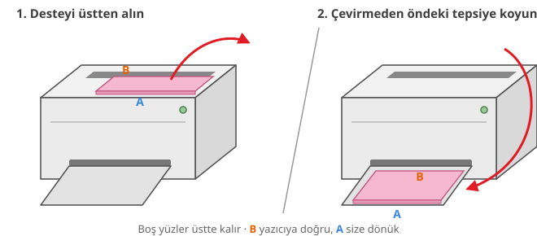

<p align="center">
  
</p>

<h1 align="center">Yazdır</h1>

<p align="center">
  <b>Arkalı önlü ünitesi olmayan yazıcılar için kitapçık, kâğıt başına N sayfa ve rehberli arkalı önlü baskı.</b><br>
  Linux için CUPS üzerinde çalışan küçük bir GTK 4 / libadwaita uygulaması.
</p>

<p align="center">
  <a href="README.md">English</a> ·
  <a href="#kurulum">Kurulum</a> ·
  <a href="#elle-arkalı-önlü-ayarı">Ayar</a> ·
  <a href="examples">Örnekler</a> ·
  <a href="docs/hp-laserjet-1018.tr.md">HP LaserJet 1018 kurulumu</a>
</p>

<p align="center">
  
  
  
  
</p>

<p align="center">
  
  &nbsp;
  
</p>

---

Yazdır, iki yüze basamayan eski bir HP LaserJet 1018 için ortaya çıktı ve tam da bu tür yazıcılar için yapıldı:
kâğıdı siz çevirirsiniz, sıra, yön ve sayfa düzeni işini uygulama halleder.

## Özellikler

- **Rehberli elle arkalı önlü.** Önce ön yüzleri basar, iş kuyruktan çıkana kadar bekler, sonra desteyi nasıl geri
  koyacağınızı resimle gösterir. *Devam*'a basınca arka yüzler doğru kâğıda, doğru yönde basılır.
- **Kitapçık.** Sayfalar yeniden dizilir (8|1, 2|7, …); basılan deste ortadan katlanınca sırayla okunan bir A5 kitapçık olur.
- **Kâğıt başına N sayfa.** 1, 2, 4, 6, 9 ya da 16 sayfa. Izgara ve kâğıt yönü en büyük ölçeği verecek şekilde seçilir.
- **Kitap gibi ya da takvim gibi çevirme.** Arka yüzün yana mı yukarı mı çevrilerek okunacağını seçersiniz; dikey ve
  yatay kâğıtlarda doğru çalışır.
- **Kâğıt kaymaz.** Yüz sayısı tekse son kâğıdın arkası, üzerinde gözle görülmeyecek kadar küçük bir nokta olan boş bir
  sayfa olarak gönderilir. Böylece boş sayfaları atlayan sürücüler sonraki bütün kâğıtların sırasını kaydıramaz.
- **Beklenen her şey.** Sayfa aralığı (`1-3,5,8-`), tek/çift sayfalar, kopya, harmanlama, ters sıra, sığdır / %100 /
  özel ölçek, döndürme, kenar boşluğu ve çerçeve.
- **Resimler de.** PNG, JPEG, WebP, TIFF… İsteğe bağlı *keskin siyah-beyaz* (600 DPI, lazer yazıcıda çizimler için ideal)
  ya da [Real-ESRGAN](https://github.com/xinntao/Real-ESRGAN) ile *AI büyütme*.
- **Derli toplu arayüz.** Sık kullanılanlar önde; gelişmiş ayarlar, başlığında varsayılandan farklı olanları yazan
  açılır bölümlerde. *Sıfırla* düğmesi *Yazdır*'ın yanında.
- Düzenlenmiş PDF'i basmadan **önizleyin ya da kaydedin**.
- **Türkçe ve İngilizce**; sistem dilini izler ya da uygulamadan seçilir.

## Elle arkalı önlü nasıl çalışır

<p align="center"></p>

1. Yazdır her kâğıdın her *yüzünü* hazırlar, ön yüzleri (1, 3, 5, … yüzler) tek iş olarak gönderir.
2. Pencere, CUPS'ın o işi bitirmesini bekler.
3. Basılan desteyi resimde gösterildiği gibi çıktı tepsisinden besleme tepsisine taşırsınız.
4. Yazdır arka yüzleri (…, 6, 4, 2 yüzler) ikinci iş olarak gönderir.

İki şey yazıcınızın kâğıt yoluna bağlı; ikisi de **Gelişmiş ayarlar → Elle arkalı önlü ayarı** altında birer anahtar:

| Ayar | Neden var | Varsayılan |
|---|---|---|
| 2. turda sırayı ters çevir | Çoğu yazıcı çıktıyı son basılan kâğıt üstte kalacak şekilde dizer ve yeniden beslemede ilk o kâğıt girer. | Açık |
| Arka yüzü 180° döndür | Destenin nasıl geri konduğuna göre arka yüz, ön yüzle aynı kenardan ya da karşı kenardan başlayarak basılır. | Açık |

Varsayılanlar HP LaserJet 1018/1020/P1102 gibi C yollu yazıcılara uyar (destenin üstünden besler, yüzü aşağı çıkarır,
desteyi çevirmeden geri koyarsınız). Başka yazıcılarda test sayfasını bir kez basıp ayarlayın.

## Düzenler

<p align="center"></p>
<p align="center"><sub>Kitapçık kâğıdının önü (8 | 1) ve arkası (2 | 7) · kâğıt başına 2 sayfa · çerçeveli kâğıt başına 4 sayfa</sub></p>

## Kurulum

### Gereksinimler

- CUPS'lı Linux (`lp`, `lpstat`)
- PyGObject, GTK 4 ve libadwaita ≥ 1.6 ile Python 3.10+
- Resim basmak için ImageMagick 7 (`magick`); PDF'ler onsuz da basılır

```sh
# Fedora
sudo dnf install python3-gobject gtk4 libadwaita cups-client ImageMagick
# Debian 13 / Ubuntu 24.10 ve sonrası (libadwaita 1.6+)
sudo apt install python3-gi gir1.2-gtk-4.0 gir1.2-adw-1 cups-client imagemagick
# Arch
sudo pacman -S python-gobject gtk4 libadwaita cups imagemagick
```

### Kurulum

```sh
git clone https://github.com/onesvat/yazdir.git
cd yazdir
./install.sh             # Real-ESRGAN'ı da indirmek için --with-ai ekleyin (~45 MB)
```

Kurulum için root gerekmez. `~/.local/share/yazdir` altında sistemdeki GTK bağlantılarını görebilen bir sanal ortam
kurar, `~/.local/bin/yazdir` bağlantısını oluşturur; uygulama menüsü kaydı, simge ve dosya yöneticisi eylemi ekler.
Varsa [`uv`](https://github.com/astral-sh/uv), yoksa `python -m venv` kullanır.

Güncellemek için `git pull && ./install.sh`. Kaldırmak için `./install.sh --uninstall` (ayarları da silmek için `--purge`).

## Kullanım

- **Uygulama menüsü:** *Yazdır*
- **Dosyalar (Nautilus):** sağ tık → *Betikler* → *Yazdır…*
- **Terminal:** `yazdir dosya.pdf resim.png …`
- Dosyaları pencereye **sürükleyip bırakın**.

| Ana seçenekler | |
|---|---|
| Baskı türü | Tek yüz · Arkalı önlü (elle) · Kitapçık |
| Çevirme | Kitap gibi (yana) · Takvim gibi (yukarı) |
| Kâğıt başına sayfa | 1 · 2 · 4 · 6 · 9 · 16 |
| Kopya sayısı | 1–99 (arkalı önlü kopyalar her zaman harmanlanır) |

| Gelişmiş bölüm | Seçenekler |
|---|---|
| Kâğıt ve kalite | A4 · A5 · Letter · Legal, Normal / Taslak, kenar boşluğu |
| Sayfalar ve kopyalar | sayfa aralığı, tek/çift sayfalar, ters sıra, harmanlama |
| Yerleşim ve ölçek | sayfa sıralaması, çerçeve, sığdır / gerçek boyut / özel %, döndürme |
| Resimler | yok · keskin siyah-beyaz · AI + keskin |
| Elle arkalı önlü ayarı | 2. turu ters çevir, arka yüzü döndür, ek not, test sayfası |
| Uygulama | dil |

Ayarlar `~/.config/yazdir/settings.json` dosyasında saklanır. *Sıfırla* baskı ayarlarını varsayılana döndürür; yazıcı,
dosya listesi, elle arkalı önlü ayarı ve dil korunur.

## Elle arkalı önlü ayarı

1. **Gelişmiş ayarlar → Elle arkalı önlü ayarı** altında **Test sayfası bas**'a basın (2 kâğıt).
2. Desteyi pencerede gösterildiği gibi geri koyup **Devam**'a basın.
3. Sonucu kontrol edin: 1'in arkasında 2, 3'ün arkasında 4 olmalı ve kâğıdı kitap gibi çevirince **↑ ÜST ↑** iki yüzde
   de aynı kenarda durmalı.

| Ne görüyorsunuz | Çözüm |
|---|---|
| Arka yüzler baş aşağı | *Arka yüzü 180° döndür*'ü değiştirin |
| Arka yüzler yanlış kâğıtta (ör. 1'in arkasında 4) | *2. turda sırayı ters çevir*'i değiştirin |
| Desteyi resimdekinden farklı geri koyuyorsunuz | kendi adımlarınızı *Ek not*'a yazın; pencere onu gösterir |

## Örnek set

[`examples/`](examples) klasöründe [İngilizce](examples/en) ve [Türkçe](examples/tr) yedi belge var. Kendi başlarına
işe yarar, aynı zamanda her modu test eder. Her sayfada test kodu, **↑ ÜST ↑** ve sayfa numarası olan küçük bir başlık var.

| # | Dosya | Ne | Ayarlar | Kâğıt | Beklenen |
|---|---|---|---|---|---|
| T1 | `1-weekly-planner.pdf` | 4 haftalık planlayıcı | Arkalı önlü, kitap gibi | 2 | 1'in arkası 2, 3'ün arkası 4 |
| T2 | `2-note-pages.pdf` | çizgili, kareli, noktalı, Cornell | Arkalı önlü, kitap gibi | 3 | son kâğıt boş geçer |
| T3 | `3-pocket-planner-booklet.pdf` | A5 cep ajandası, Kasım 2026 – Ekim 2027 | Kitapçık | 2 | ortadan katlayın: 1 → 8 okunur |
| T4 | `4-lists-2up.pdf` | alışveriş ve yapılacaklar listeleri (A5) | Arkalı önlü, kitap gibi, kâğıt başına 2 | 2 | 1·2'nin arkası 3·4 |
| T5 | `5-recipe-cards-4up.pdf` | 16 tarif kartı (A6) | Arkalı önlü, kitap gibi, kâğıt başına 4, çerçeve | 2 | çerçevelerden kesin |
| T6 | `6-monthly-calendar.pdf` | Kasım 2026 – Şubat 2027 | Arkalı önlü, takvim gibi | 2 | arkayı okumak için yukarı çevirin |
| T7 | `7-trackers.pdf` | alışkanlık takibi, okuma listesi, hedefler | Arkalı önlü, kitap gibi, 2 kopya | 4 | iki takım; iki kâğıt boş geçer |

Kaynaklar [`examples/src`](examples/src) içindeki [Typst](https://typst.app) dosyaları; tek kaynak iki dili de üretir.
Türkçe sürümde sabit tarihli resmî tatiller de işaretli.

## Yazıcı notları

- **HP LaserJet 1018 / 1020 / P1102 ve benzerleri:** firmware için HP eklentisine ve `hpcups` sürücüsüne ihtiyaç duyar.
  Bkz. [docs/hp-laserjet-1018.tr.md](docs/hp-laserjet-1018.tr.md).
- İşler `lp -o scaling=100` ile gönderilir, çünkü Yazdır her yüzü zaten kâğıt boyutunda hazırlar. `OutputMode`
  (Normal/Taslak) bir `hpcups` seçeneğidir; diğer sürücüler yok sayar.
- Çoğu yazıcı kenardaki ~4 mm'ye basamaz; varsayılan kenar boşluğunun 5 mm olması bu yüzden.

## Dil

Arayüz sistem dilini izler (`LANGUAGE`, `LC_ALL`, `LC_MESSAGES`, `LANG`). Değiştirmek için **Gelişmiş ayarlar →
Uygulama** altından dil seçin ya da `YAZDIR_LANG=tr yazdir` ile başlatın.

Çeviriler `src/yazdir/locale/<dil>.po` dosyalarında ve doğrudan okunur, derlemeye gerek yok. Yeni dil eklemek için
`yazdir.pot`'u `<dil>.po` olarak kopyalayıp çevirin, kodu `src/yazdir/i18n.py` içindeki `LANGUAGES`'e ekleyin; isterseniz
bir `feed-diagram-<dil>.svg` de ekleyin.

## Geliştirme

```sh
just setup        # sistem GTK bağlantılarıyla .venv, düzenlenebilir kurulum, pytest ve ruff
just test         # motor testleri (sayfa sırası, kitapçık, boş yüzler, döndürme, turlar)
just lint
just run tr       # kaynak ağacından Türkçe çalıştır
just examples     # örnek PDF'leri yeniden üret (typst gerekir)
just pot          # çeviri şablonunu güncelle ve tr.po ile birleştir
just screenshots  # README ekran görüntülerini baskı yapmadan yeniden üret
```

Motor, [pypdf](https://github.com/py-pdf/pypdf) üzerine yazılmış düz Python: her kaynak sayfa bir dönüşüm matrisiyle
kâğıda yerleştirilir, yatay kâğıtlar dikey kâğıda çevrilir, arka yüzler de çevirme şekli, kâğıt yönü ve ayar
gerektirdiğinde 180° döndürülür.

## Lisans

[MIT](LICENSE) © 2026 Onur Neşvat
